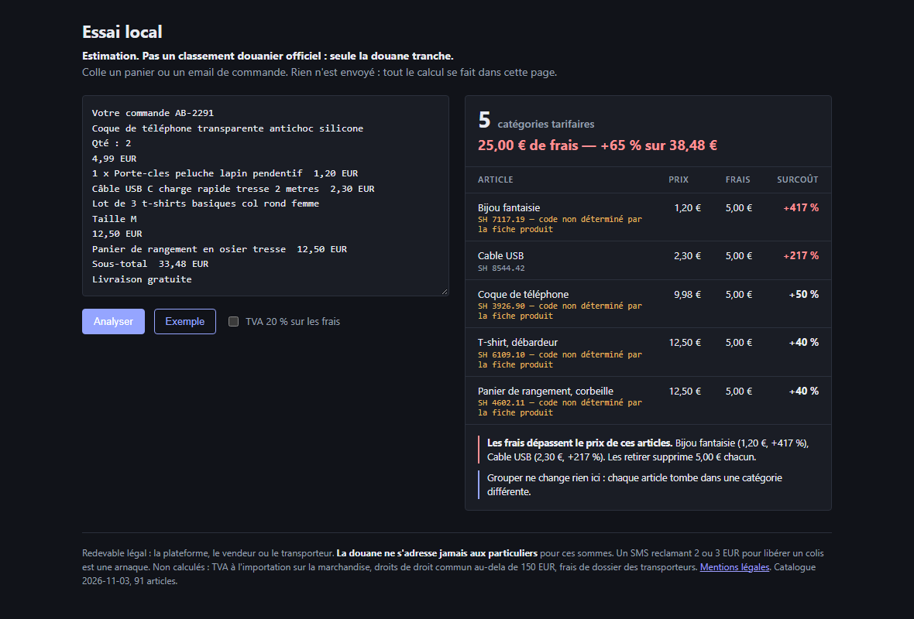

# colis

[](https://github.com/amdjadouxx/colis/actions/workflows/ci.yml)
[](LICENSE)

Moteur de calcul des frais douaniers **par catégorie tarifaire** pour les envois hors UE vers la France, et le site qui l'expose.

> **Estimation, pas un classement douanier officiel.**
> Les sous-positions utilisées sont les classements usuels de ces articles. Seule l'administration des douanes est compétente pour trancher. Les montants réellement dus dépendent du classement retenu au dédouanement, de la valeur déclarée et des conditions de vente.
> Ne sont pas calculés : la TVA à l'importation sur la marchandise, les droits de droit commun au-delà de 150 €, et les frais facturés par les transporteurs.
> Les redevables sont la plateforme, le vendeur ou le transporteur — **l'administration des douanes ne s'adresse jamais aux particuliers** pour leur paiement.

**État : fonctionnel en local, non déployé.** `npm run check:deploy` liste ce qui reste ouvert. Les marques éventuellement citées le sont à titre descriptif ; ce projet n'est affilié à aucune place de marché.

Depuis le 1ᵉʳ juillet 2026 un droit forfaitaire de 3 € s'applique par catégorie d'article (envois ≤ 150 €), et depuis le 1ᵉʳ novembre 2026 s'y ajoutent 2 € de frais de traitement, sans seuil de valeur. Le coût d'une commande ne dépend donc pas du nombre d'articles mais du **nombre de sous-positions tarifaires distinctes** qu'elle contient.



Les forfaits frappent en proportion inverse du prix : sur cet exemple, une babiole à 1,20 € porte **+417 %** de frais là où un article à 12,50 € en porte 40 %. C'est ce classement par ligne qui a de la valeur — le total, lui, se calcule de tête.

## Ce que ça résout, et ce que ça ne résout pas

La règle simple — « groupe les articles identiques » — est déjà publique et largement diffusée. Ce qui ne l'est pas, c'est la **frontière** : un t-shirt en coton et un t-shirt en polyester sont deux catégories (`6109.10` / `6109.90`) ; un rouge à lèvres et un mascara aussi (`3304.10` / `3304.20`), alors que tout le monde les compte comme « cosmétiques » ; un bonnet et une casquette n'en font qu'une (`6505.00`).

Et dans beaucoup de cas la réponse est **indéterminable** : le code à 6 chiffres dépend de la fibre, du tricotage ou de la matière du dessus, informations quasi absentes des fiches produits. Le moteur rend alors un intervalle au lieu d'un chiffre faussement précis. C'est la seule position défendable, et c'est le cœur du projet.

## Architecture

```
packages/partition   solveur min/max exact des catégories, zéro dépendance
packages/rules       barèmes versionnés (données, pas code)
packages/catalog     catalogue d'articles + résolution texte → codes candidats
packages/parse       lecture d'un panier collé : libellés, quantités, prix, devises
packages/extract     choix de la zone panier dans une page, sans sélecteur par site
packages/analyse     répartition des frais par ligne et taux de surcoût effectif

apps/web             page autonome, générée
apps/extension       extension de navigateur, permission activeTab seule
apps/api             Worker Cloudflare, calcul local synchrone

test/                politiques du dépôt : aucun réseau, aucun stockage
tools/               build, sondes, contrôles négatifs, garde-fous
```

### Le solveur

Compter les catégories d'un panier où certains articles portent plusieurs codes candidats, c'est deux problèmes distincts :

- **minimum** = couverture minimale (set cover). Résolu **exactement** par séparation et évaluation, en branchant sur l'article le plus contraint. Un glouton est faux ici : il répond 3 là où 2 est atteignable, et il y a un test qui le prouve (`le minimum est exact, pas glouton`).
- **maximum** = couplage maximal biparti articles ↔ codes (Kuhn).

L'incertitude ne crée un intervalle **que si deux articles peuvent partager un code**. Un article seul dans sa famille compte pour 1 quelle que soit sa fibre. C'est pour ça que les fourchettes restent serrées au lieu de s'additionner.

### Les barèmes sont des données

Le régime actuel est transitoire : la réforme de l'union douanière européenne doit le remplacer en 2028. `packages/rules` liste les régimes avec leurs dates, montants, seuils et sources officielles. 2028 = un objet JSON de plus, le moteur ne bouge pas. C'est l'actif durable du projet — pas la page.

### Pourquoi LinkUp n'est pas dans le chemin de requête

LinkUp est l'un des providers du Cloudflare Web Search API (beta depuis le 2 octobre 2026, ~5 $/1000 requêtes, ZDR via Cloudflare). Décision prise et assumée : **aucun appel sortant par visiteur**.

1. La nomenclature TARIC n'est pas une donnée de recherche web, elle est structurée et publiée mensuellement. On la récupère une fois par mois et on l'embarque.
2. Un appel payant par visiteur met un coût marginal sur un outil gratuit à trafic inconnu.
3. Une recherche en direct rend la réponse non déterministe. Or la promesse de la page est « on te dit quand on ne sait pas ». Un chiffre qui change entre deux chargements détruit ça.

LinkUp sert donc **hors chemin critique**, en cron : détecter que les montants ou les dates ont bougé, et enrichir le catalogue. Quelques dizaines de requêtes par jour, pas des dizaines de milliers. `tools/rules-watch` ne modifie **rien** tout seul : il échoue bruyamment et la correction du barème reste manuelle, parce qu'un montant faux est pire qu'un jour de retard.

## Développement

```bash
npm install
npm test                 # 23 tests, aucune dépendance de test
npm run dev              # Worker en local
npm run sync:taric       # nomenclature ; --dry-run pour voir sans écrire
LINKUP_API_KEY=... npm run watch:rules
```

## API

```
GET  /v1/catalog    catalogue et version
GET  /v1/rules      barèmes connus, celui en vigueur en tête
POST /v1/estimate   { items: string[], goodsValue?, includeVat?, onDate? }
POST /v1/resolve    { text: string }
```

`POST /v1/estimate` rend le nombre de catégories (min, max, `certain`), les collisions acquises et possibles, le coût, et `ifOrderedSeparately` — le contrefactuel qui dit si grouper sert à quelque chose.

## Déploiement

Paliers gratuits : Workers 100 000 requêtes/jour, Pages illimité en statique, Web Analytics sans cookie (donc pas de bandeau RGPD à gérer). `*.workers.dev` et `*.pages.dev` suffisent pour mesurer. Un `.fr` à ~7 €/an vaut mieux qu'un TLD gratuit exotique si le SEO devient l'enjeu.

```bash
npx wrangler deploy
```

## La seule métrique qui compte

Le projet est déployé pour savoir **si quelqu'un l'utilise**, pas pour être complet. À définir avant d'ajouter une ligne de fonctionnalité : un seuil, une date, et la décision d'arrêter si le seuil n'est pas atteint.

Contexte chiffré pour calibrer les attentes : entre juin et juillet 2026, les volumes ont chuté de 50 % chez Temu, 43 % chez DHGate, 37 % chez AliExpress, 15 % chez Shein (étude Joko, panel de 1,5 M de consommateurs), pendant que le panier moyen montait de 30 % chez Temu. Autrement dit l'audience se contracte et a déjà appris à grouper seule. Le projet n'a pas été validé par des entretiens clients : la volonté de payer est **non mesurée**, et rien ici ne prétend le contraire.

## Avertissement

Les sous-positions du catalogue sont les classements usuels de ces articles, **pas un classement officiel** : seule la douane tranche. Le redevable légal est la plateforme, le vendeur ou le transporteur — la douane ne s'adresse jamais aux particuliers pour ces sommes. Ne sont pas calculés : la TVA à l'importation sur la marchandise, les droits de droit commun au-delà de 150 €, et les frais de dossier des transporteurs, qui sont libres et non réglementés.

Sources : [douane.gouv.fr](https://www.douane.gouv.fr/petits-colis-ce-qui-change-pour-vos-achats-en-ligne) · [economie.gouv.fr](https://www.economie.gouv.fr/particuliers/mes-droits-conso/bien-consommer/tout-savoir-sur-la-taxe-sur-les-petits-colis) · [TARIC open data mirror](https://github.com/rousseauxy/taric-opendata)

## Documentation

| | |
|---|---|
| [docs/validation-du-concept.md](docs/validation-du-concept.md) | Le test qui a servi à réfuter le concept, ses seuils posés à l'avance, et pourquoi il échoue sur son critère décisif |
| [docs/juridique.md](docs/juridique.md) | Ce qui est vérifié, ce qui est raisonné, ce qui reste ouvert. Rédigé pour une relecture par un juriste |
| [docs/deploiement.md](docs/deploiement.md) | Trois portes à franchir, seuil d'arrêt chiffré, modèles de mentions légales et d'avertissement |
| [docs/backlog.md](docs/backlog.md) | Ce qui reste, dans l'ordre |
| [CONTRIBUTING.md](CONTRIBUTING.md) | Démarrer, ajouter un article au catalogue, modifier un barème |
| [SECURITY.md](SECURITY.md) | Le modèle de confidentialité et comment il est tenu par des tests |

## Garanties de qualité

Le projet ne se contente pas de tests qui passent.

| Contrôle | Commande | Ce qu'il garantit |
|---|---|---|
| Suite unitaire et d'invariants | `npm test` | moteur, parseur, barèmes, catalogue, absence de réseau |
| Contrôles négatifs | `npm run check:negative` | les bugs connus font bien **rougir** la suite, vérifié sur copie |
| Équivalence du bundle | `npm run verify:local` | la page livrée calcule comme les sources |
| Extraction en navigateur | `npm run test:extension` | le script réellement injecté lit la bonne zone |
| Garde-fou de mise en ligne | `npm run check:deploy` | ce qui reste ouvert avant publication |

Les contrôles négatifs réintroduisent douze bugs connus sur une copie du dépôt et vérifient que la suite échoue à chaque fois. Un test qui passe ne prouve rien s'il passe aussi quand le code est cassé.

Le fuzz par invariants génère des paniers au format aléatoire et vérifie des propriétés qui doivent tenir quel que soit le format : conservation du nombre d'articles, de la valeur totale, absence de prix inventé.

## Licence

**GNU AGPL v3**, voir [LICENSE](LICENSE).

Ce code est libre : tu peux l'utiliser, le modifier et le redistribuer. En contrepartie, toute version modifiée doit rester sous la même licence — **y compris si elle est exploitée comme service en ligne**, sans être distribuée. C'est la différence entre l'AGPL et la GPL, et c'est la raison de ce choix : le moteur ne peut pas être repris dans un service fermé.

Le logiciel est fourni « tel quel », **sans garantie d'aucune sorte**. Voir aussi l'avertissement en tête de ce fichier sur la nature des estimations.

**Obligation en cas de déploiement.** L'article 13 de l'AGPL impose d'offrir le code source aux personnes qui interagissent avec le logiciel à distance, à travers un réseau. La page et l'extension s'exécutent entièrement dans le navigateur, donc le code est déjà entre les mains de l'utilisateur. En revanche, le jour où `apps/api` serait déployé comme service, un lien visible vers ce dépôt devient obligatoire.
